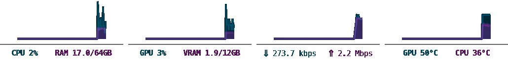
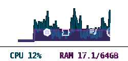
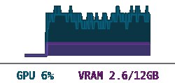
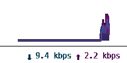
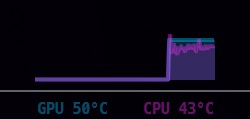

<div align="center">

# Nocturne

**Five Rainmeter skins in one visual language: transparent background, 250 px
wide, a graph on top and a two-value readout underneath.**


<br>



*The four live widgets, captured at a 1 s update with a transparent background. The Clock is shown separately below.*

</div>

---

## Contents

- [The widgets](#the-widgets)
- [Repository contents](#repository-contents)
- [Readout](#readout)
- [Graphs: when to autoscale](#graphs-when-to-autoscale)
- [GPU: why NVML](#gpu-why-nvml-not-usageMonitor-or-nvidia-smi)
- [CPU temperature: PawnIO + Intel MSRs](#cpu-temperature-pawnio--intel-msrs)
- [Encoding](#encoding-always-use-utf-16le-for-skins-with-symbols)
- [Colour source](#colour-source)
- [Source folders](#source-folders)
- [Deploying on a fresh machine](#deploying-on-a-fresh-machine)

---

## The widgets

### CPU and RAM



CPU load + system RAM used.

### Gpu



GPU load + video RAM used, read from NVML.

### Network



Download + upload throughput. The arrows are real Unicode (U+21D3 / U+21D1)
drawn in the suite font — no font substitution to go wrong.

### Temp



GPU temperature + CPU temperature. The CPU reading needs PawnIO and an elevated
Rainmeter; without them it shows `CPU --°C` rather than a fabricated number.

### Clock


Day name, letter-spaced, with a glow. This is the odd one out: it is a port of
Connect-R's Mond clock and keeps its own `Scale` / `BgWidth` variables, its
`letters.lua` layout script, the Anurati font and a `Language` include. It does
not use the 250 px graph-and-readout layout the other four share.

The background panel is sized to the word: `letters.lua` measures the current
day name's ink width and pushes it into a `DayWordW` skin variable that the
background meter's `W=` reads, so the panel adapts per day. The height (`DayH`)
is constant because the font size is. Both dimensions are centred on the glyph
ink, so the margins above/below and before/after the word are equal; at the
default scale MONDAY measures 1674×296 (panel 1674×290).

All five default to **Update=1000**. Change `Update=` in the `[Rainmeter]`
section of each `.ini` to adjust.

## Repository contents

This repo holds the skins actually in use, not a reference collection:

```
Nocturne/          this suite
SASMusicPlayer/    S.A.S. Music Player for Web (vendor skin, 118 ini files)
BasiliskPower/     BasiliskPower (battery widget for the Razer Basilisk mouse)
@Vault/            Rainmeter plugin vault, not a skin
```

`BasiliskPower/` is published separately at
<https://github.com/Anu-bhav/razer-basilisk-power>.

Everything else that used to live here — Mond monitors 1-3, Simplic,
SimplyRound, Socks, illustro, Cleartext, WeatherX, UnPlayer,
WebNowPlayingRedux — was removed on 2026-11-22. It is recoverable from git
history if you want a reference back.

## Readout

```
CPU 12%    RAM 11.2/64GB
GPU 9%     VRAM 1.5/12GB
GPU 48°C   CPU 44°C
↓ 1.2mbps  ↑ 0.4mbps
```

Each readout is **one String meter** centred on `X=125`, the middle of the
250 px line, with the second half recoloured through an inline setting.

That is deliberate. Centring two separate meters on their own ¼ and ¾ points
does **not** centre the pair: `GPU 9%` is narrow while `VRAM 1.5/12GB` is
wide, so the block drifts right of centre (measured 7-11 px). One centred meter
is centred by construction at any digit count.

The Network readout is the exception: it is an arrow plus a value, drawn as
separate meters (see [Why the arrows are Unicode](#why-the-arrows-are-unicode)).

```ini
[Readout]
Meter=String
StringAlign=Center
X=125
Text="GPU %1%    VRAM [mVramGB:1]/[mVramTotalGB:0]GB"
InlineSetting=Color | #FontColor2#
InlinePattern=VRAM.*
```

### `%N` takes no printf specifiers

Rainmeter's `%1`, `%2` substitutions accept **plain placeholders only**. A
`%2.1f` is *not* a format specifier: Rainmeter substitutes `%2` and then
prints `.1f` as literal text, which is where a stray `f` next to the numbers
comes from.

Verified with a test skin:

| Text | Rendered |
|---|---|
| `%1` | `11.234` |
| `%1.1f` | `11.23.1f`  ← the stray `f` |
| `[m:0]` | `11` |
| `[m:1]` | `11.2` |
| `[m:2]` | `11.23` |
| `[m:1]/[mBig:0]GB` | `11.2/12GB` |

Use a section-variable format modifier, which also lets each measure have its
own decimal count — something the meter-wide `NumOfDecimals` option cannot do:

```ini
Text="GPU %1%    VRAM [mVramGB:1]/[mVramTotalGB:0]GB"
```

The `%1` (the GPU percentage) stays a plain placeholder; only the decimal
measures use the `:N` form.

### Inline settings are matched pairs

`InlineSetting` goes with `InlinePattern`, `InlineSetting2` with
`InlinePattern2`. Mismatching the numbers silently does nothing, or recolours
everything. Numbering must also have no gaps: an `InlineSetting2` without an
`InlineSetting` makes Rainmeter discard the whole block.

### Why the arrows are Unicode

The Network skin used to draw its arrows with Wingdings 3 and
`InlinePattern2=p ` — p plus a trailing space, to avoid matching the `p` in
`mbps`. **Rainmeter's INI parser trims trailing whitespace from option values**,
so the regex that reached the engine was a bare `p`. That matched all three
`p` characters in `q 1.2mbps    p 0.4mbps`, turning the unit into `Mb<arrow>s`.

The arrows are real Unicode (U+21D3 down, U+21D1 up) drawn in the suite font;
no font swap, no pattern that can eat the unit.

The arrows are emphasised with a **separate String meter** per arrow, set to
`FontSize=19` and `FontWeight=900` — the largest and heaviest styling the
suite font offers (`MesloLGS NF` ships Regular + Bold only, and Rainmeter
4.5.28 silently ignores inline `Size` and `Weight`, so inline emphasis can no
longer carry the weight). They read as the primary glyph rather than matching
the digits.

Note that `StringStyle=Bold` is a **no-op** here. The suite asks GDI+ for the
family name `MesloLGS NF Regular` — a *style*, not a family — so there is no
bold face to link to; the emphasis comes from the heavier glyph at a larger
size.

## Graphs: when to autoscale

`AutoScale=1` rescales each graph to its own min/max every frame. Great for a
metric that moves, misleading for one that doesn't:

| Metric | AutoScale | Fixed 0-100 |
|---|---|---|
| VRAM 1.7/12 GB (12%) | line pinned at **top** | 12% height correct |
| RAM 11/64 GB (17%) | line near **top** | 17% height correct |

| Skin | AutoScale | Fixed 0-100 |
|---|---|---|
| CPU and RAM | CPU | RAM |
| Gpu | GPU | VRAM |
| Temp | — | both (0-100 °C) |
| Network | both (naturally bursty) | — |

Verified empirically: with `AutoScale=1` a constant 12 rendered at the top
whether `MinValue`/`MaxValue` were set or not — AutoScale ignores them.

**Temp fixes both graphs at 0-100 °C.** A temperature has an absolute meaning
that autoscaling destroys: a CPU at 45 °C and one at 85 °C would draw the same
height, so the graph could no longer show whether the part is hot. Fixed
scaling keeps 50 °C at half height. Both measures carry `MinValue=0` /
`MaxValue=100` and the meters use `AutoScale=0`.

## GPU: why NVML, not UsageMonitor or nvidia-smi

**Not `UsageMonitor`.** Sums per-engine/per-process utilisation; reported
34-46% while the GPU was at 4%. Filtering to 3D engines still gave 38.8%.

**Not `nvidia-smi`.** Accurate, but ~45 ms per process launch. Polling once a
second cost ~1.5% CPU — more than every other skin combined.

**NVML via `NocturneGpu.dll`.** Reads `nvml.dll`, which ships with every NVIDIA
driver, in-process. ~0.08% CPU.

The plugin must be in `%APPDATA%\Rainmeter\Plugins\` and is 64-bit. Source and
build script: `_Source\SimplicGpu\`.

## CPU temperature: PawnIO + Intel MSRs

Windows exposes no CPU temperature through any documented API, and the ACPI
thermal zone is a firmware stub. Both were measured on this machine (MSI PRO
Z790-A WIFI, i9-13900KF):

| Source | Result |
|---|---|
| `\Thermal Zone Information(*)\Temperature` | 301 / 3010, **never changes** |
| `MSAcpi_ThermalZoneTemperature` (**elevated**) | 3010 -> 27.85 °C, **never changes** |
| `EsifDeviceInformation` (Intel DTT) | class absent; `esifsvc` not installed |
| `MSFT_ThermalZoneTemperature` | invalid namespace |
| `Win32_PerfFormattedData_ThermalZoneInformation` | invalid class |
| `Win32_TemperatureProbe` | `32768`, WMI's "unknown" sentinel |

The decisive test sampled elevated under 12-28% sustained CPU load: the raw
value stayed pinned at **3010** while `ThermalStamp` advanced normally
(8278 -> 8306). Windows was polling and the ACPI call was succeeding — the
firmware returns a constant.

`0x0BC2` = 3010 is the hard-coded fallback branch motherboard vendors put at
the end of `TZ00._TMP`. Confirmed locally without a decompiler:
`GetSystemFirmwareTable` shows both `TZ00` and `0x0BC2` present in this
machine's DSDT. Two unrelated boards elsewhere have had their tables dumped
showing the same branch, so it is a vendor pattern rather than a one-off.

The same 3010 reads as 30.1 °C when treated as tenths-of-°C instead of
tenths-of-Kelvin — one constant, two plausible-looking numbers. That is how it
survived several rounds of testing.

### Reading the real sensor

Real per-core temperature lives in machine-specific registers reachable only
from ring 0. [PawnIO](https://pawnio.eu) is a signed ring-0 IO driver that
loads small signed **Pawn modules**. The official
[IntelMSR](https://github.com/namazso/PawnIO.Modules) module permits reading an
allowlist of MSRs, and `NocturneCpuTemp.dll` uses it:

| MSR | Purpose |
|---|---|
| `0x1A2` `IA32_TEMPERATURE_TARGET` | TjMax in bits 23:16 (100 °C here) |
| `0x19C` `IA32_THERM_STATUS` | current temperature in bits 22:16 |

```
TjMax = (MSR_TEMPERATURE_TARGET >> 16) & 0xFF
T     = TjMax - ((MSR_THERM_STATUS >> 16) & 0x7F)
```

Verified live: 35-47 °C idle, 35-46 °C under a 24-worker load, 45 -> 37 °C
during cooldown. It moves, which is the whole point.

### Requirements

- **PawnIO installed.** It ships with some apps (here: OpenRGB, v2.2.0.0). The
  registry key
  `HKLM\SOFTWARE\Microsoft\Windows\CurrentVersion\Uninstall\PawnIO` gives
  `InstallLocation`; the plugin also probes `%ProgramFiles%\PawnIO`.
- **Rainmeter must run elevated.** PawnIO's INF sets
  `HKR,,Security,,"D:P(A;;GA;;;SY)(A;;GA;;;BA)"` — SYSTEM and Builtin
  Administrators only. An unelevated open returns `ERROR_ACCESS_DENIED`, which
  is why the skin shows `CPU --°C` instead of a number in that state.
- The `IntelMSR` blob is **embedded in the DLL** (5,452 bytes) so there is no
  side file to lose or version-skew. Source:
  <https://github.com/namazso/PawnIO.Modules/releases/tag/0.2.12> (LGPL-2.1).
  Regenerate with `_Source\SimplicCpuTemp\gen_blob.ps1` after a module release.
  Only the official signed module loads; the driver verifies the signature.

On this machine elevation is arranged with a scheduled task
(`RainmeterElevated`, trigger *at logon*, run level *Highest*) instead of the
Startup-folder shortcut, since a Startup shortcut cannot elevate and a "run as
administrator" shortcut would prompt at every logon.

### When it cannot read

`Update()` returns **-1.0**, never a fabricated 0 °C. The skin's Calc wrapper
maps that to `-1` and `Substitute="-1":"--"` turns it into `--`, so the readout
shows `CPU --°C` rather than implying a physically impossible sub-zero reading.
The graph treats the negative value as empty.

This happens if PawnIO is missing, the module is rejected, or Rainmeter is not
elevated.

CPU temperature needs an **Intel** CPU — the `IntelMSR` module's `main()`
returns `STATUS_NOT_SUPPORTED` on AMD.

## Encoding: always use UTF-16LE for skins with symbols

`°` must not be stored as UTF-8 `C2 B0`. Rainmeter decodes that as CP1252 on
this setup and renders `°`.

**UTF-8 does not work here, even with a BOM.** Verified by A/B: two files with
identical text, one UTF-8 with BOM, one UTF-16LE with BOM. The UTF-8 file
rendered the arrows as garbage; the UTF-16LE file rendered them correctly.

`Temp/Temp.ini` and `Network/Network.ini` are UTF-16LE with a BOM. If you edit
them in an editor that defaults to UTF-8, the symbols will break — save them
back as UTF-16LE.

```powershell
[System.IO.File]::WriteAllText(
    $path, $text, (New-Object System.Text.UnicodeEncoding($false, $true)))
```

## Transparency

Rainmeter skins are transparent by default (`BackgroundMode=1`, and none of
these skins define a `Background`). The 2 px line under each graph is a
separator, not a background.

The GIFs in `Images/` are transparent too, so they pick up whatever background
the README is viewed against.

## Colour source

All colours come from `@Resources\Variables.inc`:

| Variable | Value | Used for |
|---|---|---|
| `FontColor1` | `0,202,255,100` | cyan — text, lines |
| `FontColor2` | `255,43,255,100` | magenta — second readout half, lines |
| `FontColor3` | `255,255,255,100` | white — divider |
| `FontColor1_Area` | `0,202,255,51` | cyan graph fill |
| `FontColor2_Area` | `255,43,255,51` | magenta graph fill |

Text and line alpha is **100**, area fills **51**. The area fill is
deliberately fainter so overlapping graphs do not turn to mud.

## Source folders

- `_Source\SimplicGpu\` — the NVML plugin (C++, MinGW, no CRT).
  Options: `Metric=Usage` (default) | `VramUsed` | `VramTotal` | `Temp` |
  `Name`, plus `Index`.
- `_Source\SimplicCpuTemp\` — the CPU temperature plugin (C++, MinGW, no
  CRT). Reads Intel MSRs through PawnIO. `IntelMSR_blob.h` is generated from
  the official `IntelMSR.bin` by `gen_blob.ps1`.
- `_Source\RainmeterFreeze\` — RainmeterFreeze plus the multi-monitor patch.

Both plugins are built with the MinGW toolchain bundled with Strawberry Perl
(`C:\Strawberry\c\bin\g++.exe`). Each `build.bat` drops the DLL next to
itself; copy it to `%APPDATA%\Rainmeter\Plugins\`.

### RainmeterFreeze multi-monitor patch

Upstream freezes Rainmeter whenever the foreground window is maximized, on any
monitor. With skins on only one screen, a maximised window elsewhere would
freeze them while still visible.

The patch adds `OnlyFreezeOnRainmeterMonitor` (default **true**) and a tray
toggle, so a window on a secondary monitor never freezes Rainmeter.

Upstream: <https://github.com/ascpixi/RainmeterFreeze> (GPL-2.0)

## Deploying on a fresh machine

1. Install Rainmeter.
2. Clone this repo into `%USERPROFILE%\Documents\Rainmeter\Skins`.
3. Build both plugins from `_Source\` and copy `NocturneGpu.dll` and
   `NocturneCpuTemp.dll` to `%APPDATA%\Rainmeter\Plugins\`.
4. For CPU temperature only: install PawnIO, then make Rainmeter run elevated
   (scheduled task at logon with run level Highest).
5. Refresh Rainmeter. The Temp skin shows `CPU --°C` until both of the above
   are in place; everything else works immediately.

---

<div align="center">
<sub>Colours and layout by Anu-Bhav · <a href="https://github.com/Anu-bhav/rainmeter-skins">source</a></sub>
</div>