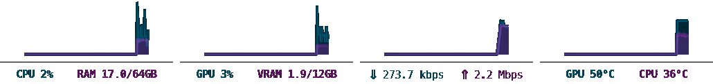
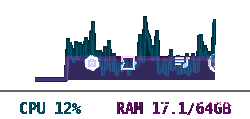
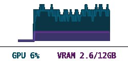
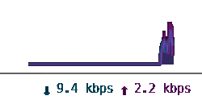
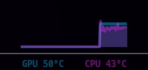
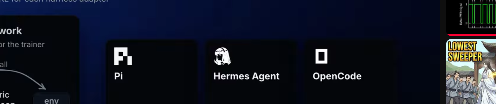

<div align="center">

# Rainmeter Skins

**A personal Rainmeter setup: Nocturne, a suite of my own, plus the
third-party skins I run alongside it.**


<br>



*The four live widgets, running together. Real captures at a 1 s update, transparent
background — no mockups.*

</div>

---

## Contents

- [What's in the box](#whats-in-the-box)
- [Nocturne](#nocturne)
- [The rest of the setup](#the-rest-of-the-setup)
- [Quick start](#quick-start)
- [Design notes](#design-notes)
- [Credits](#credits)

---

## What's in the box

| Folder | What it is | Licence |
|---|---|---|
| [`Nocturne/`](Nocturne/) | My own suite: five widgets, two custom plugins | GPL-2.0 (+ LGPL-2.1 module) |
| [`BasiliskPower/`](BasiliskPower/) | Battery widget for the Razer Basilisk mouse | see folder |
| [`SASMusicPlayer/`](SASMusicPlayer/) | S.A.S. Music Player for Web (vendor skin) | see folder |
| [`@Vault/`](@Vault/) | Rainmeter plugin vault, not a skin | — |

Everything else that used to live here — Mond monitors 1–3, Simplic,
SimplyRound, Socks, illustro, Cleartext, WeatherX, UnPlayer,
WebNowPlayingRedux — was removed on 2026-11-22. It is recoverable from git
history if you want it back.

---

## Nocturne

Five skins in one visual language: transparent background, 250 px wide, a graph
on top and a two-value readout underneath.

| Widget | Readout | Size | Update |
|---|---|---:|---:|
| [CPU and RAM](Nocturne/CPU%20and%20RAM/) | CPU load + system RAM | 250×119 | 1000 ms |
| [Gpu](Nocturne/Gpu/) | GPU load + video RAM | 250×119 | 1000 ms |
| [Network](Nocturne/Network/) | Download + upload | 250×123 | 1000 ms |
| [Temp](Nocturne/Temp/) | GPU temperature + CPU temperature | 250×119 | 1000 ms |
| [Clock](Nocturne/Clock/) | Day name, letter-spaced, with a glow | varies × 296 | 1000 ms |

The Clock is the odd one out: it is a port of Connect-R's Mond clock and keeps
its own `Scale` / `BgWidth` variables, its `letters.lua` layout script, the
Anurati font and a `Language` include.

### CPU and RAM



**CPU load + system RAM**, cyan and magenta over a shared graph.

### Gpu



**Overall GPU load + video RAM**, read from NVML.

### Network



**Download + upload throughput.** The arrows are real Unicode (U+21D3 / U+21D1)
drawn in the suite font, so there is no font substitution to go wrong.

### Temp



**GPU temperature + CPU temperature.** The CPU reading needs PawnIO and an
elevated Rainmeter; without them it shows `CPU --°C` rather than a made-up
number.

### Clock



**Day name, letter-spaced.** Anurati's glyphs vary 10× in width (`I` is 32 px
while `W` is 324 px), so `CharacterSpacing` cannot produce even gaps. A
`letters.lua` pass positions every glyph by its measured ink extent instead.

The background panel is **not** fixed-width: `letters.lua` measures the current
word's ink width and pushes it into a `DayWordW` skin variable that the
background meter's `W=` reads, so the panel adapts to the day name. The height
(`DayH`) is constant because the font size is. Both dimensions are centred on
the glyph ink, so the margins above/below and before/after the word are equal.
At the default scale MONDAY measures 1674×296 (panel 1674×290); TUESDAY is
wider at 1732×296.

**Hover glow.** At rest the clock is subtle — background panel at 4% opacity,
text at 39%. On hover the skin jumps to full opacity (`!SetTransparency 255`),
revealing the solid black panel and a vivid magenta shadow glow (`#ShadowColor`,
`ShadowBlur = 2×Scale`). Move the mouse away and it fades back (`!SetTransparency 100`).

Full documentation for the suite, including the plugin API and the
CPU-temperature research, is in **[Nocturne/README.md](Nocturne/README.md)**.

---

## The rest of the setup

### BasiliskPower

Battery widget for the Razer Basilisk mouse, published separately at
<https://github.com/Anu-bhav/razer-basilisk-power>.

### SASMusicPlayer

Vendor skin, 118 ini files, unmodified. Runs alongside the suite.

---

## Quick start

1. Install [Rainmeter](https://www.rainmeter.net/) (64-bit).
2. Clone this repo into your Rainmeter skins folder:

   ```powershell
   cd ~/Documents/Rainmeter
   git clone git@github.com:Anu-bhav/rainmeter-skins.git Skins
   ```

   Or clone somewhere else and point Rainmeter's `SkinPath` at it.

3. Build the plugins. They are not committed as binaries — build them from
   source:

   ```powershell
   cd "Nocturne\_Source\SimplicGpu"
   .\build.bat
   cd "..\SimplicCpuTemp"
   .\build.bat
   ```

   Both need MinGW-w64 (the toolchain bundled with Strawberry Perl works).

4. Copy them into Rainmeter's plugin folder:

   ```powershell
   copy "Nocturne\_Source\SimplicGpu\NocturneGpu.dll" "$env:APPDATA\Rainmeter\Plugins\"
   copy "Nocturne\_Source\SimplicCpuTemp\NocturneCpuTemp.dll" "$env:APPDATA\Rainmeter\Plugins\"
   ```

5. For the CPU temperature reading only: install
   [PawnIO](https://pawnio.eu) and make Rainmeter run elevated. See
   [Nocturne/README.md](Nocturne/README.md#requirements) for the scheduled-task
   approach.

6. Restart Rainmeter, then load the skins from **Manage**.

---

## Design notes

### Why the readout is one String meter

Each readout is a single String meter centred on `X=125`, the middle of the
250 px line, with the second half recoloured through an inline setting.

Centring two separate meters on their own quarter points does **not** centre the
pair. `GPU 9%` is narrow while `VRAM 1.5/12GB` is wide, so the block drifts
right — measured at 7–11 px. One centred meter is centred by construction at
any digit count.

The Network readout is the exception: it is an arrow plus a value, drawn as
separate meters (see
[Why the arrows are Unicode](#why-the-arrows-are-unicode)).

### Why the graphs don't all autoscale

`AutoScale=1` rescales each graph to its own min/max every frame. Great for a
metric that moves, misleading for one that doesn't.

| Metric | With AutoScale | Fixed 0–100 |
|---|---|---|
| VRAM 1.7/12 GB (12%) | line pinned at the **top** | 12% height |
| RAM 11/64 GB (17%) | line near the **top** | 17% height |

So each skin autoscales the dynamic metric and fixes the constant one.
Temperatures are fixed at 0–100 °C, because a temperature has an absolute
meaning that autoscaling destroys.

### Why `%2.1f` does not work

Rainmeter's `%1`, `%2` substitutions accept **plain placeholders only**. A
`%2.1f` is not a format specifier: Rainmeter substitutes `%2` and then prints
`.1f` as literal text. That is where a stray `f` next to the numbers comes from.

Use a section-variable format modifier instead, which also lets each measure
have its own decimal count:

```ini
Text="GPU %1%    VRAM [mVramGB:1]/[mVramTotalGB:0]GB"
```

### Why the arrows are Unicode

The Network widget used to draw its arrows with Wingdings 3 and
`InlinePattern2=p ` — but Rainmeter's INI parser trims trailing whitespace from
option values, so the regex that reached the engine was a bare `p`. That matched
the `p` inside `mbps` as well, turning the unit into `Mb<arrow>s`.

Real Unicode arrows remove the whole problem: no font swap, no pattern that can
eat the unit.

### Why skin files with symbols must be UTF-16LE

Rainmeter on this setup decodes UTF-8 (even with a BOM) as CP1252, so `°`
becomes `°` and arrows become mojibake. UTF-16LE with a BOM decodes correctly.
Every skin here that contains non-ASCII uses it.

---

## Credits

| Project | Author | Licence |
|---|---|---|
| Nocturne | Anu-Bhav | GPL-2.0 |
| IntelMSR Pawn module | namazso | LGPL-2.1 |
| RainmeterFreeze | ascpixi | GPL-2.0 |
| Simplic (original) | HipHopium | see original |
| Clock (basis) | Connect-R | see original |

The `IntelMSR` module is embedded in `NocturneCpuTemp.dll` and is LGPL-2.1 as
shipped upstream. Source:
<https://github.com/namazso/PawnIO.Modules>.

---

<div align="center">
<sub>Built with care and a lot of measuring.</sub>
</div>