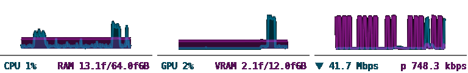

# Simplic Suite

Three Rainmeter widgets in one visual language: transparent background,
250px wide, a graph on top and a two-value readout underneath.

| Skin | File | Shows |
|---|---|---|
| CPU and RAM | `CPU and RAM/cpu_ram.ini` | CPU load + system RAM used |
| Network | `Network/Network.ini` | Download + upload throughput |
| Gpu | `Gpu/GPU.ini` | GPU load + video RAM used |

All three default to **Update=1000**. Change `Update=` in the `[Rainmeter]`
section of each `.ini` to adjust.

## Preview



| CPU and RAM | Gpu | Network |
|:---:|:---:|:---:|
|  |  |  |

These are real captures, recorded with the skins running: CPU load was
generated to move the graph, a CUDA-free D3D11 load generator exercised the
GPU, and a file download drove the network widget.

## Readout

```
CPU 12%    RAM 11.2/64GB
GPU 9%     VRAM 1.5/12GB
q 1.2mbps  p 0.4mbps
```

Each readout is **one String meter** centred on `X=125` — the middle of the
250px line — with the second half recoloured through an inline setting.

That is deliberate. Centring two separate meters on their own ¼ and ¾ points
does **not** centre the pair: `GPU 9%` is narrow while `VRAM 1.5/12GB` is
wide, so the visual block drifts right of centre (measured 7–11px). One
centred meter is centred by construction at any digit count.

```ini
[Readout]
Meter=String
StringAlign=Center
X=125
Text="GPU %1%    VRAM %2.1f/%3.0fGB"
InlineSetting=Color | #FontColor2#
InlinePattern=VRAM.*
```

**Inline settings are matched pairs.** `InlineSetting` goes with
`InlinePattern`, `InlineSetting2` with `InlinePattern2`. Mismatching the
numbers silently does nothing (or recolours everything), which is an easy
way to end up with a magenta label.

The Wingdings arrows on the Network skin are part of the same string via an
inline font change, so they can no longer overlap the numbers.

## Graphs: hybrid scaling

Rainmeter's `AutoScale=1` rescales each graph to its own min/max every
frame. Great for a metric that moves, misleading for one that doesn't:

| Metric | AutoScale | Fixed 0–100 |
|---|---|---|
| VRAM 1.7/12 GB (12%) | line pinned at **top** | 12% height ✓ |
| RAM 11/64 GB (17%) | line near **top** | 17% height ✓ |

So each skin uses autoscale for the dynamic metric and fixed scaling for
the constant one:

| Skin | AutoScale | Fixed 0–100 |
|---|---|---|
| CPU and RAM | CPU | RAM |
| Gpu | GPU | VRAM |
| Network | both (naturally bursty) | — |

Verified empirically: with `AutoScale=1` a constant 12 rendered at the top
whether `MinValue`/`MaxValue` were set or not — AutoScale ignores them.

## GPU: why NVML, not UsageMonitor or nvidia-smi

**Not `UsageMonitor`.** It sums per-engine/per-process utilisation and
reports 34–46% while the GPU is at 4%. Filtering to 3D engines still gives
38.8%.

**Not `nvidia-smi`.** Accurate, but ~45 ms per process launch. Polling it
once a second cost ~1.5% CPU — more than every other skin combined.

**NVML via `SimplicGpu.dll`.** Reads `nvml.dll` (ships with every NVIDIA
driver) in-process. ~0.08% CPU.

The plugin must be in `%APPDATA%\Rainmeter\Plugins\` and is 64-bit.
Source and build script: `_Source\SimplicGpu\`.

## CPU temperature: not available on this hardware

A combined GPU+CPU temperature widget was built and then removed. This
section records why, so it does not get attempted a third time.

**GPU temperature is easy.** NVML (`nvml.dll`, shipped with every NVIDIA
driver) exposes temperature in-process, which `SimplicGpu.dll` already
reads at ~0.08% CPU.

**CPU temperature is not readable here, even with administrator rights.**
Windows exposes no documented CPU temperature API. Every route was tried
on this machine (MSI PRO Z790-A WIFI, i9-13900KF):

| Source | Result |
|---|---|
| `\Thermal Zone Information(*)\Temperature` | 301 / 3010, **never changes** |
| `MSAcpi_ThermalZoneTemperature` (elevated) | 3010 → 27.85 °C, **never changes** |
| `EsifDeviceInformation` (Intel DTT) | class absent; `esifsvc` not installed |
| `MSFT_ThermalZoneTemperature` | invalid namespace |
| `Win32_PerfFormattedData_ThermalZoneInformation` | invalid class |
| `Win32_TemperatureProbe` | `32768`, WMI's "unknown" sentinel |

The decisive test: sampled elevated under 12–28 % sustained CPU load, the
raw value stayed pinned at **3010** while `ThermalStamp` advanced normally
(8278 → 8306). Windows was polling and the ACPI call was succeeding — the
firmware simply returns a constant.

3010 is `0x0BC2`, the hard-coded fallback branch that motherboard vendors
put at the end of `TZ00._TMP`. Two unrelated boards in the wild have had
their ACPI tables dumped and decompiled showing exactly this, so it is a
vendor pattern rather than a one-off. Note the same 3010 also reads as
30.1 °C when treated as tenths-of-°C rather than tenths-of-Kelvin; one
constant, two plausible-looking numbers.

The real per-core sensors live in MSRs reachable only from ring 0, which is
why Core Temp, HWiNFO and LibreHardwareMonitor all ship a kernel driver.
Adding one was out of scope, so the widget was removed rather than left
displaying a fabricated 27.85 °C.

To have real CPU temperature, install **Core Temp** (free, and the
`CoreTemp.dll` Rainmeter plugin is already present in
`C:\Program Files\Rainmeter\Plugins\`) or **LibreHardwareMonitor**, then
add a skin using `Plugin=CoreTemp` with `CoreTempType=Temperature`.

## Encoding: use UTF-16LE for skins with a `°`

`°` must not be stored as UTF-8 `C2 B0`. Rainmeter decodes that as CP1252
on this setup and renders `°`. Every working skin on this machine
(WeatherX, Mond Weather) stores it as UTF-16LE with a `FF FE` BOM, or as a
single-byte `B0`.

## Transparency

Rainmeter skins are transparent by default (`BackgroundMode=1` is the
default and none of these skins define a `Background`). The 2px line under
each graph is a separator, not a background.

## Colour source

All colours come from `@Resources\Variables.inc` (`FontColor1` cyan,
`FontColor2` magenta, `FontColor3` white) so every widget stays in sync.

## Source folders

- `_Source\SimplicGpu\` — the NVML plugin (C++, MinGW build).
- `_Source\RainmeterFreeze\` — RainmeterFreeze plus the multi-monitor
  patch described below.

### RainmeterFreeze multi-monitor patch

Upstream freezes Rainmeter whenever the foreground window is maximized, on
any monitor. With skins on only one screen, a maximised window elsewhere
would freeze them while still visible.

The patch adds `OnlyFreezeOnRainmeterMonitor` (default **true**) and a tray
toggle, so a window on a secondary monitor never freezes Rainmeter.

Upstream: <https://github.com/ascpixi/RainmeterFreeze> (GPL-2.0)