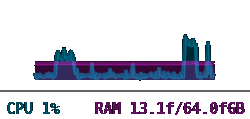

# Simplic Suite

Four Rainmeter widgets in one visual language: transparent background,
250px wide, a graph on top and a two-value readout underneath.

| Skin | File | Shows |
|---|---|---|
| CPU and RAM | `CPU and RAM/cpu_ram.ini` | CPU load + system RAM used |
| Network | `Network/Network.ini` | Download + upload throughput |
| Gpu | `Gpu/GPU.ini` | GPU load + video RAM used |
| Temp | `Temp/Temp.ini` | GPU temperature + CPU temperature |

All four default to **Update=1000**. Change `Update=` in the `[Rainmeter]`
section of each `.ini` to adjust.

## Preview


| CPU and RAM | Gpu | Network |
|:---:|:---:|:---:|
|  |  |  |

These are real captures, recorded with the skins running: CPU load was
generated to move the graph, a CUDA-free D3D11 load generator exercised the
GPU, and a file download drove the network widget.

## Readout

```
CPU 12%    RAM 11.2/64GB
GPU 9%     VRAM 1.5/12GB
GPU 48°C    CPU 44°C
q 1.2mbps  p 0.4mbps
```

Each readout is **one String meter** centred on `X=125` — the middle of the
250px line — with the second half recoloured through an inline setting.

That is deliberate. Centring two separate meters on their own ¼ and ¾ points
does **not** centre the pair: `GPU 9%` is narrow while `VRAM 1.5/12GB` is
wide, so the visual block drifts right of centre (measured 7–11px). One
centred meter is centred by construction at any digit count.

```ini
[Readout]
Meter=String
StringAlign=Center
X=125
Text="GPU %1%    VRAM %2.1f/%3.0fGB"
InlineSetting=Color | #FontColor2#
InlinePattern=VRAM.*
```

The Temp skin is the same idea for temperatures:

```ini
[Readout]
Meter=String
MeasureName=mGPUTemp
MeasureName2=mCPUTemp
StringAlign=Center
X=125
Text="GPU %1°C    CPU %2°C"
InlineSetting=Color | #FontColor2#
InlinePattern=CPU.*
```

**Inline settings are matched pairs.** `InlineSetting` goes with
`InlinePattern`, `InlineSetting2` with `InlinePattern2`. Mismatching the
numbers silently does nothing (or recolours everything), which is an easy
way to end up with a magenta label.

The Wingdings arrows on the Network skin are part of the same string via an
inline font change, so they can no longer overlap the numbers.

## Graphs: hybrid scaling

Rainmeter's `AutoScale=1` rescales each graph to its own min/max every
frame. Great for a metric that moves, misleading for one that doesn't:

| Metric | AutoScale | Fixed 0–100 |
|---|---|---|
| VRAM 1.7/12 GB (12%) | line pinned at **top** | 12% height ✓ |
| RAM 11/64 GB (17%) | line near **top** | 17% height ✓ |

So each skin uses autoscale for the dynamic metric and fixed scaling for
the constant one:

| Skin | AutoScale | Fixed 0–100 |
|---|---|---|
| CPU and RAM | CPU | RAM |
| Gpu | GPU | VRAM |
| Network | both (naturally bursty) | — |

Verified empirically: with `AutoScale=1` a constant 12 rendered at the top
whether `MinValue`/`MaxValue` were set or not — AutoScale ignores them.

## GPU: why NVML, not UsageMonitor or nvidia-smi

**Not `UsageMonitor`.** It sums per-engine/per-process utilisation and
reports 34–46% while the GPU is at 4%. Filtering to 3D engines still gives
38.8%.

**Not `nvidia-smi`.** Accurate, but ~45 ms per process launch. Polling it
once a second cost ~1.5% CPU — more than every other skin combined.

**NVML via `SimplicGpu.dll`.** Reads `nvml.dll` (ships with every NVIDIA
driver) in-process. ~0.08% CPU.

The plugin must be in `%APPDATA%\Rainmeter\Plugins\` and is 64-bit.
Source and build script: `_Source\SimplicGpu\`.

## CPU and GPU temperature: two different worlds

**GPU is easy.** NVML (`nvml.dll`, shipped with every NVIDIA driver) exposes
load, VRAM and temperature in-process, which is what `SimplicGpu.dll` reads.
No external process, ~0.08% CPU.

**CPU has no such API.** Windows does not publish a CPU temperature through
any documented interface:

| Attempted | Result |
|---|---|
| WMI `MSAcpi_ThermalZoneTemperature` (`root/WMI`) | Access denied |
| WMI `MSFT_ThermalZoneTemperature` (`Root/Microsoft/Cooling`) | Invalid namespace |
| `Win32_TemperatureProbe` | Returns empty `CurrentReading` |
| CoreTemp / SpeedFan plugins | Need their own app running |

What does work without elevation or a helper app is the ACPI thermal zone
exposed as a performance counter:
`\Thermal Zone Information(*)\Temperature`. `SimplicCpuTemp.dll` reads it
through `pdh.dll`, resolved at runtime, so there is no import library and
nothing extra to ship.

Two gotchas, both found by dumping the raw buffer rather than guessing:

- **The formatted double is already in tenths.** `301.0` means 30.1 °C.
  Scaling it again by 10 is wrong.
- **The item stride is not what the header implies.** `bufSize / itemCount`
  gives 44 bytes per item here, not 24, and the temperature is a 32-bit
  LONG at offset 16. Reading an 8-byte double at that offset yields a
  denormal and the value looks like 0.

`Index` selects the thermal zone (default 0, which is `\_TZ.TZ00` on ACPI
systems). The measure reports degrees Celsius directly and `Reload` sets
`maxValue` to 100 so graphs scale 0-100 °C.

## Encoding: use UTF-16LE for skins with a `°`

`°` must not be stored as UTF-8 `C2 B0` here. Rainmeter decodes that as
CP1252 on this setup and renders `°`. Every working skin on this machine
(WeatherX, Mond Weather) stores it as UTF-16LE with a `FF FE` BOM, or as a
single-byte `B0`. `Temp/Temp.ini` is saved as UTF-16LE.

## Transparency

Rainmeter skins are transparent by default (`BackgroundMode=1` is the
default and none of these skins define a `Background`). The 2px line under
each graph is a separator, not a background.

## Colour source

All colours come from `@Resources\Variables.inc` (`FontColor1` cyan,
`FontColor2` magenta, `FontColor3` white) so every widget stays in sync.

## Source folders

- `_Source\SimplicGpu\` — the NVML plugin (C++, MinGW build).
- `_Source\SimplicCpuTemp\` — the ACPI thermal-zone plugin (C++, MinGW build).
- `_Source\RainmeterFreeze\` — RainmeterFreeze plus the multi-monitor
  patch described below.

### RainmeterFreeze multi-monitor patch

Upstream freezes Rainmeter whenever the foreground window is maximized, on
any monitor. With skins on only one screen, a maximised window elsewhere
would freeze them while still visible.

The patch adds `OnlyFreezeOnRainmeterMonitor` (default **true**) and a tray
toggle, so a window on a secondary monitor never freezes Rainmeter.

Upstream: <https://github.com/ascpixi/RainmeterFreeze> (GPL-2.0)